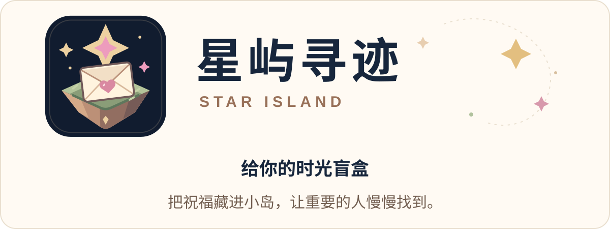
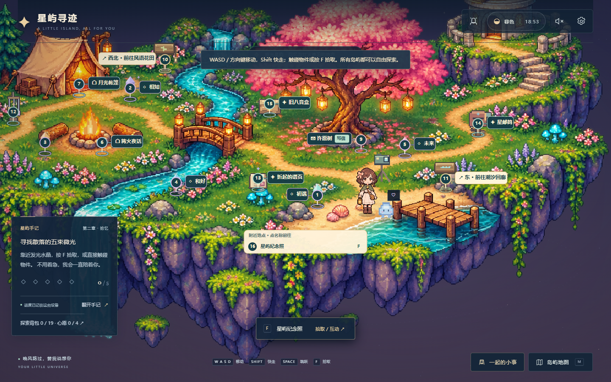
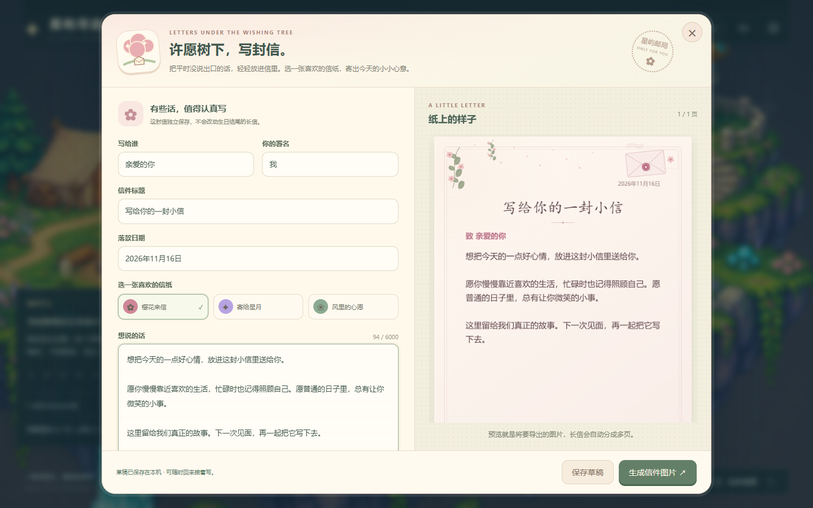

<div align="center">

<picture>
  <source media="(prefers-color-scheme: dark)" srcset="docs/images/star-island-banner-dark.svg">
  
</picture>

**A time capsule, made for someone special.**

**English** · [简体中文](README.zh-CN.md)

[](https://github.com/bobo8886/star-island/releases/latest) [](https://github.com/bobo8886/star-island/actions/workflows/check.yml) [](LICENSE)

[](docs/DEVELOPMENT.md) [](docs/USER_GUIDE.md) [](https://github.com/bobo8886/star-island/stargazers)

[](https://bobo8886.github.io/star-island/) [](https://github.com/bobo8886/star-island/releases/latest) [](docs/CUSTOMIZATION.md)

[Guide](docs/USER_GUIDE.md) · [Sharing](docs/DEPLOYMENT.md) · [Changelog](CHANGELOG.md) · [Feedback](https://github.com/bobo8886/star-island/issues/new/choose)

</div>

A customizable birthday adventure that runs in your browser, online or offline. Explore four pixel-art islands, collect memories, spend time with a companion, and write a letter beneath the wishing tree. Make the names, dates, stories, photos, voice messages, and final surprise your own.

> Free for personal use, modification, gifting, and noncommercial sharing. **Commercial use, resale, and paid delivery are prohibited.** See the [license](LICENSE).



## 🎮 Start exploring

- **Play now:** open the [live game](https://bobo8886.github.io/star-island/) in a desktop or mobile browser.
- **Play offline:** download `star-island-v6.2.2-offline.zip` from [Releases](https://github.com/bobo8886/star-island/releases/latest), extract it, and open `星屿寻迹.html`. A standalone HTML download is also available.
- **Work on the code:** get the [source](https://github.com/bobo8886/star-island/archive/refs/heads/main.zip) and follow the [development guide](docs/DEVELOPMENT.md).

No account or developer tools are required to play. On phones, the live game is the easiest option; file preview apps may not run HTML games.

**中文 / English:** choose your language on the first visit (Chinese is selected by default). Change it anytime from the top bar or Settings. Built-in stories, interactions, letters, gift editor and birthday fireworks are bilingual. Progress stays intact, and your own writing and uploaded audio remain unchanged. Detailed guides are currently in Chinese.

## 🎁 Make it a personal gift

1. Choose **“制作一份专属礼物” (Make a personal gift)** on the welcome screen. Enter the recipient, your name, and the birthday.
2. Add five memories, photos, and voice messages. Write the final letter in the letter and ending section.
3. Select **“保存这份心意” (Save)**, then **“导出礼物” (Export gift)**. Send the new HTML file or [publish it as a website](docs/DEPLOYMENT.md).

The recipient starts a fresh journey. **Saving locally does not change the public demo URL**—share the exported file to include your personal content. See the [customization guide](docs/CUSTOMIZATION.md).

## ✨ A small world to discover

| Experience | What awaits |
| --- | --- |
| 🗺️ Explore freely | Four islands, 44 marked locations, 19 story objects, and four side quests |
| 💎 Collect memories | Find five crystals, connect a constellation, and open the birthday letter |
| 🧸 Choose a companion | Play as the girl traveler with a guide spirit, a male companion, or on your own |
| 🐚 Share little moments | Swing, build a sandcastle, stroll, take photos, plant flowers, float paper boats, skip stones, and turn a windmill |
| 💌 Write a letter | Three stationery themes, saved drafts, high-resolution PNG images, and TXT export |
| 🎆 Enjoy the scenery | Flowing water, falling petals, day and night, original music, and fireworks after the finale |

Write beneath the wishing tree at any time. Save the letter as an image to send through WeChat or another app. Your private tree-letter draft is kept out of exported birthday games.

<details>
<summary><strong>Preview the letter-writing desk</strong></summary>



Edit beside a live preview on desktop, or switch between writing and preview on mobile. Images are 1080 pixels wide; long letters split into pages. See the [letter guide](docs/USER_GUIDE.md#6-许愿树下写一封信).

</details>

## Controls and saves

**Desktop:** WASD or arrow keys to move, `F` to interact, `Shift` to move faster, Space to jump, `M` for the map, and `J` for the journal. Click the ground or a location label to navigate. **Mobile:** use the on-screen joystick and action buttons.

Progress, text, and media stay in the current browser; there is no cloud sync. Export a backup from Settings before switching devices or clearing browser data. More help is in the [player guide](docs/USER_GUIDE.md).

## 📖 Documentation

The detailed guides below are in Simplified Chinese.

| I want to… | Read |
| --- | --- |
| Learn the controls, explore, and finish the birthday story | [Player guide](docs/USER_GUIDE.md) |
| Change names, dates, stories, photos, and letters | [Personalization](docs/CUSTOMIZATION.md) |
| Send a gift or publish a custom URL | [Deployment and sharing](docs/DEPLOYMENT.md) |
| Edit the code and build an offline copy | [Development](docs/DEVELOPMENT.md) |

## Project layout

```text
src/       Game logic and stories
assets/    Artwork and provenance
docs/      Player and developer guides
scripts/   Build and release tools
tests/     Core and browser checks
```

`index.html` is the development entry point; `星屿寻迹.html` is the generated offline game. See the [file reference](docs/PROJECT_STRUCTURE.md) for details.

## Verification

Version 6.2.2 passed **eight core suites, nine offline gifting checks, and a live-site launch check**. For development:

```sh
npm test
npm run build
npm run check:bundle
```

Choose browser checks from the [testing guide](docs/TESTING.md). Results and coverage limits are recorded in [VERIFICATION.md](VERIFICATION.md). These commands are not required to play.

## License and contributions

The [custom noncommercial license](LICENSE) allows free personal use, modification, gifting, and noncommercial sharing. Commercial use, resale, paid customization or delivery, and advertising monetization are prohibited. Keep the license and attribution when redistributing the game. Your own photos, voice recordings, and writing remain yours or their original owners'. Exported games retain the full notices.

This is a source-available project with commercial-use restrictions, not an MIT-licensed project. The Chinese license text is authoritative; see [third-party notices](THIRD_PARTY_NOTICES.md) for asset and tool provenance.

[Report a problem](https://github.com/bobo8886/star-island/issues/new/choose) · [Contribute](CONTRIBUTING.md) · [Report a security issue privately](SECURITY.md) · [Changelog](CHANGELOG.md)

<div align="center">


Thank you for sharing your stories and helping this little island grow.

[⭐ Keep Star Island close](https://github.com/bobo8886/star-island)

</div>
