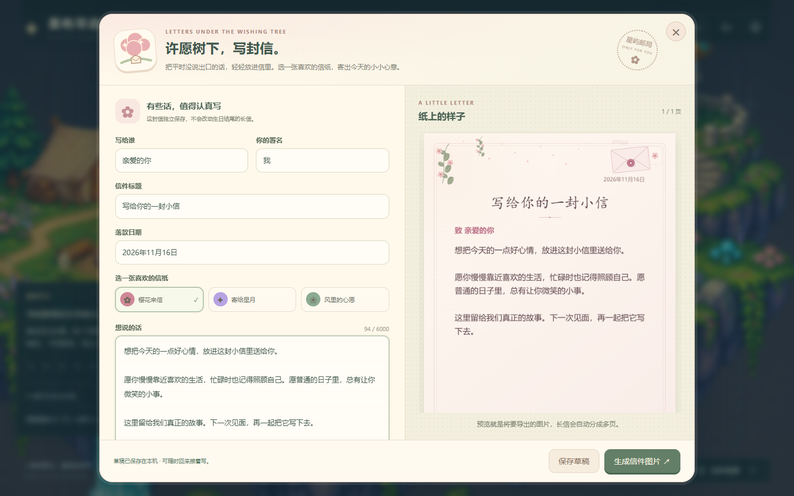

# 新手游玩教程

《星屿寻迹：给你的时光盲盒》是一款可以在浏览器里玩的生日探索小游戏。你可以直接体验模板，也可以先把称呼、回忆、照片和最后的信改成自己的，再送给朋友。游戏不需要注册账号。

这份教程对应 **6.3** 版的中文默认名称。赠送者可以修改地图、回忆和互动文案，收到定制版本时，请以屏幕上的名称和提示为准。

首次进入会显示语言选择卡，默认选中简体中文，也可选择 English。下次会记住选择；顶部「中 / EN」和设置的「语言」可重新打开选择卡。切换后页面会重新载入，探索进度保留。内置模板随语言切换，自己填写的名字、故事、信件及上传的语音保持原样；如想制作英文礼物，建议先选择 English 再编辑。浏览器禁止存储时，当前页面仍可通过语言参数切换。

[返回项目首页](../README.md) · [制作专属礼物教程](CUSTOMIZATION.md)

## 1. 下载与打开

### 方法 A：直接打开离线文件

适合只想游玩、编辑祝福或给朋友制作礼物的人。

1. 下载仓库的 ZIP 并完整解压。也可以单独下载根目录里的 [星屿寻迹.html](../星屿寻迹.html) 文件。
2. 在电脑上用浏览器打开 `星屿寻迹.html`。下载的是 HTML 文件本身时才可以离线打开；保存 GitHub 的文件展示页面不能代替这个文件。
3. 等待场景和角色准备完成。开始按钮显示 **「开启这场奇遇」** 后，点击进入。
4. 阅读向导的第一段话，点击 **「把这句话收好」**，开始自由探索。

单文件已包含场景、角色、音乐、写信页等内容，不需要安装 Node.js。文件约 45 MiB，初次打开需要加载图片，等待开始按钮亮起即可。

`index.html` 是开发入口，依赖同目录的脚本、样式与素材。只想双击游玩时，请选择已经打包好的 `星屿寻迹.html`。

### 方法 B：在本机启动开发预览

适合准备改源码、查看项目结构，或用手机连接电脑预览的人。

1. 安装 Node.js；确认终端能够执行 `node --version` 和 `npm --version`。
2. 解压仓库，在包含 `package.json` 的项目目录打开终端。
3. 执行：

   ```sh
   npm start
   ```

4. 在浏览器打开 <http://127.0.0.1:4173>。
5. 保持终端运行；结束预览时在终端按 `Ctrl+C`。

项目没有运行时第三方依赖，启动和打包无需先执行 `npm install`。

### 手机怎么打开

手机可以访问已经发布的游戏网页。若还没有发布，也可以连接电脑进行局域网预览：

1. 电脑和手机连接同一个 Wi-Fi。
2. 在电脑项目目录执行：

   ```sh
   node server.js --host 0.0.0.0
   ```

3. 找到电脑的局域网 IPv4 地址。Windows 可在另一个终端执行 `ipconfig`，查看当前 Wi-Fi 对应的 IPv4 地址。
4. 在手机浏览器输入 `http://电脑的局域网IP:4173`。例如电脑地址是 `192.168.1.20`，就访问 `http://192.168.1.20:4173`。
5. 电脑必须保持开机、服务运行；若系统防火墙拦截，需要允许该服务在当前可信局域网内访问。

手机里的 `127.0.0.1` 指向手机自身，不能用它访问电脑。局域网地址也不能直接发给远方的朋友；跨网络游玩需要发布网页，或把离线 HTML 文件发给对方下载后用浏览器打开。

微信的文件预览器不一定执行 HTML 游戏。发送游戏文件时，提醒朋友下载后使用浏览器；发送树信和纪念照时，直接发送 PNG 图片即可。

## 2. 基本操作

### 电脑

| 操作 | 按键或方式 |
| --- | --- |
| 移动 | `W A S D` 或方向键 |
| 快走 | 移动时按住 `Shift` |
| 小跳 | `Space` 空格键 |
| 拾取、交谈、互动 | 靠近后按 `F`，也兼容 `E` |
| 打开地图 | `M` 或右下角「岛屿地图」 |
| 查看手记 | `J` 或左侧「翻开手记」 |
| 关闭弹窗 | `Esc` 或弹窗右上角 `×` |
| 打开设置 | 场景中按 `Esc`，或点击右上角齿轮 |
| 自动走路 | 点击可走的地面；点击交互名牌可导航到物件 |
| 缩放镜头 | 在游戏场景上滚动鼠标滚轮 |

手动走到尚未发现的物件旁，可能会自动打开剧情。看完后可以继续走；想再看一次时靠近按 `F`。输入框正在编辑文字时，字母按键不会同时控制人物。

跳跃是角色的小动作，不是跨河或穿过建筑的方法。遇到水面、树木或建筑挡路，请沿道路走，或点击地图地点让角色自动寻路。

### 手机

- 左下角摇杆控制移动。
- 右下角 **「疾行」** 按住可快走，**「跳跃」** 可小跳，**「拾取」** 对附近目标进行交互。
- 点击地图按钮、物件名牌或可走地面，也能导航。
- 弹窗内容较长时，在内容区域内上下滑动；点击 `×` 返回场景。

## 3. 看懂地图和路标

默认有四张可以往返的地图：

| 地图 | 可以做什么 |
| --- | --- |
| **拾光星屿** | 五枚记忆水晶、篝火、帐篷、观星台、许愿树写信、纪念照 |
| **风语花田** | 花间秋千、花田小故事，以及前往湖谷的路牌 |
| **潮汐回廊** | 沙堡、沿海散步、水漂，以及海岸探索故事 |
| **月见湖谷** | 种花、纸船、风车，以及绕湖探索故事 |

打开 **「岛屿地图」** 后：

1. 选择顶部的区域名称。
2. 看地图上的编号，并在旁边或下方清单中找到同一编号。
3. 清单会写明地点名称和用途，例如故事、拾取、一起互动、区域出口或树下写信。
4. 点击地图点或清单项，角色会前往该地点；选择其他区域的目标也可以进行跨区域导航。

实际场景中的名牌也可以点击。走近后出现 `F` 提示；已发现的故事或已完成的活动可重访。四张地图共 44 个可到达地点，没必要一次走完。

## 4. 完成生日主线

### 第一步：找到五枚水晶

五枚生日记忆都在主岛 **「拾光星屿」**，收集顺序自由：

| 默认主题 | 默认地点名 | 大致位置 |
| --- | --- | --- |
| 初遇 | 拾光浅滩 | 主岛浅滩附近 |
| 相知 | 月光帐篷 | 帐篷附近 |
| 日常 | 萤火营地 | 营地附近 |
| 和好 | 流萤溪畔 | 小河附近 |
| 未来 | 许愿树下 | 许愿树附近 |

可以打开地图直接选择水晶，或自己散步寻找。触碰水晶或按 `F` 后会展示回忆、照片与语音；没有配置照片时，会展示水晶插画。左侧计数会逐渐变成 **5 / 5**。

按 `J` 打开手记可以重读已收集的回忆。水晶附近的「许愿树」是另一个写信互动点；树信并不是第五枚水晶本身。

### 第二步：在观星台连星

1. 收齐五枚水晶后，到主岛的 **「观星台」**。
2. 阅读连星页面上方给出的顺序。默认是：

   **初遇 → 相知 → 日常 → 和好 → 未来**

3. 按这个顺序点击对应的星星。若回忆主题被赠送者修改，页面会显示修改后的名称，按页面顺序操作即可。
4. 点错会提示下一颗，同一次连星界面中已经点亮的星星会保留。
5. 不确定时可以点击 **「给我一点点提示」**。

### 第三步：拆开时光盲盒

完成连星后进入庆典，点击 **「拆开时光盲盒」** 阅读生日长信和心愿兑换券。你可以：

- 点击 **「保存文字」**，下载 TXT。
- 点击 **「保存信纸」**，下载带排版的 HTML 信笺；用浏览器打开后，可以使用浏览器打印功能保存为 PDF。
- 点击 **「再看一次星光」** 重看庆典效果。
- 返回小岛继续探索，之后从 **手记 → 重读那封信** 再次打开。

主线完成后，四张地图都会持续有各自主题的烟花，大字祝福每 7 秒出现一轮。主岛偏桃金爱心、花田偏花朵、海岸偏星环、湖谷偏莲花；文字可由赠送者在工坊修改。

篝火夜话、其他地图和支线都可以自由体验，不要求全部做完才能读到结尾长信。

## 5. 八种日常互动

点击右下角 **「一起的小事」**，选择活动即可前往；也可以走到相应物件旁按 `F`。

| 活动 | 地图 | 具体操作 |
| --- | --- | --- |
| 花间秋千 | 风语花田 | 点击「轻轻推一下」增加摆幅；「再走走」结束 |
| 沙滩小城堡 | 潮汐回廊 | 依次点击「堆起沙丘」「筑起两座塔」「插上星星旗」；完成后可「重新堆一个」 |
| 沿着海风散步 | 潮汐回廊 | 开始后自动沿海岸走一段；结束后可「再走一小段」，也可提前离开 |
| 星屿纪念照 | 拾光星屿 | 点击「拍下这一刻」，再点「保存纪念照」下载图片 |
| 一起种一小片花 | 月见湖谷 | 点击「播下一颗种子」，再「给种子浇水」，看花开后可重新种 |
| 把心愿放进纸船 | 月见湖谷 | 选择一句心愿，再点击「放出小纸船」 |
| 海风里的水漂 | 潮汐回廊 | 按一次开始蓄力，再按一次出手，查看弹跳结果和最好成绩 |
| 借一点风给风车 | 月见湖谷 | 反复点击「轻轻拨一下」攒起风力，触发风车与彩带效果 |

活动中的 **「留张纪念照」** 也能拍下当前画面。**「一起的小事 → 随手拍一张」** 可以记录当前位置，照片是 1600 × 1080 PNG，带相纸边框和日期。

活动记录会保存，但拍好的图片需要点击下载。最近一张照片只保留在当前页面会话中，离开页面前请保存喜欢的照片。

除此之外，还有 19 个剧情物件和四条支线。打开手记中的 **「探索背包」**，根据线索找物件、查看自己的选择和已完成心愿。支线不限定唯一探索顺序。

## 6. 许愿树下写一封信

这是一封可以随时写、保存为图片的独立信件，不需要先通关。



1. 打开地图，选择主岛的 **「许愿树」**；清单类型为「树下写信」。也可以走近许愿树按 `F`。
2. 填写 **写给谁、你的署名、信件标题、落款日期、想说的话**。日期可以留空。
3. 选择信纸：**樱花来信、寄给星月、风里的心愿**。
4. 正文默认留空。需要起笔参考时，点击 **「填入一封示例」**；已有正文时会先确认是否替换。
5. 电脑可一边写一边看预览；手机可切换 **「写信 / 信纸预览」**。
6. 草稿会在本机自动保存，也可以主动点 **「保存草稿」**。关闭后再次打开可以继续写。
7. 写好后点击 **「生成信件图片」**。按页查看并下载 PNG；手机也可以长按预览图片保存。长信会自动分页，需要逐页保存。
8. 打开微信聊天，从相册选择保存好的图片发送给朋友。也可点击 **「下载完整文字」** 保留 TXT。

每张 PNG 宽 1080 像素，最高 3600 像素；正文最多 6000 个 Unicode 字符。支持文件分享的浏览器还会显示 **「系统分享」**，目标应用由你在系统菜单中选择。

树信与生日结尾长信是两份独立内容：写树信不会改动生日结尾，导出专属生日游戏也不会把当前树信草稿一起带给收礼人。要发送这封树信，请下载图片或文字；要跨设备继续编辑，请导出完整时光备份。

## 7. 旅伴、声音与昼夜

### 换一个陪你的人

点击右上角 **「角色与旅伴」**，或在设置中找到 **「和谁一起出发」**：

- **向导精灵**：默认的小精灵。
- **男性旅伴**：会跟随并参与活动的男性角色。
- **独自探索**：关闭同行者。

主角由你操作，旅伴由游戏控制；不是两台设备联机或两名玩家同时操作。角色名字可以在礼物工坊修改。角色图鉴还能预览不同动作。

### 开启声音

点击右上角喇叭按钮开启声音。设置里的 **「声音层次」** 可以分别调整 **背景音乐、环境与交互、留言语音**。留言语音播放时，背景音乐会自动降低。

浏览器可能要求先点击页面才能播放声音。若听不到，先点喇叭，再检查设备音量和三个音量滑块；没有上传的语音不会自动出现。

### 固定喜欢的时刻

设置中的 **「岛屿时光」** 可以选择跟随现实、静谧星夜、晴朗晨光或温柔暮色。现实时间按北京时间计算。

北京时间 23:00—05:00 到帐篷休息，可以看到晚安内容；赠送者配置了晚安语音时，也能播放。手动把画面切为星夜只改变视觉时段，不会把真实时间改成深夜。

开启 **「减少动态效果」** 会减少风景动态，完成主线后的祝福改为静态星光表现。

## 8. 保存进度、换设备和重新开始

一般游玩进度会自动记在当前浏览器中。它不会通过 GitHub 账号同步到其他设备。

完整保留的方法：

1. 打开右上角设置。
2. 点击 **「导出时光备份」**，保存下载的 JSON 文件。
3. 在另一台设备或浏览器打开游戏。
4. 进入设置，点击 **「恢复时光备份」**，选择 JSON 文件。
5. 阅读恢复摘要后点击 **「确认恢复」**。

备份包含探索进度、礼物工坊内容、照片、语音、设置和树信草稿。恢复会替换目标浏览器当前的对应存档，想保留两边内容时先分别备份。

清理网站数据、使用另一个浏览器、换网址或换设备，都可能看到一份新存档。不要只依靠网页标签页长期保存重要内容。

**「重新开始这场奇遇」** 会清空主线水晶、支线、活动等探索进度，保留已保存的布置、照片、语音、设置和树信。它适合重新体验剧情；给朋友制作全新进度的版本，请使用 [导出专属礼物](CUSTOMIZATION.md)。

## 9. 常见问题

| 遇到的问题 | 怎么处理 |
| --- | --- |
| 开始按钮一直显示准备中 | 等素材加载；若提示加载失败，刷新或重新下载完整离线文件。开发版检查 `assets`、`src` 和三份 CSS 是否齐全 |
| 按键没有控制人物 | 先关闭弹窗，点击游戏场景；输入框编辑时移动键会被当作文字 |
| 点地面无法走过去 | 目标可能位于水面或障碍里；改点附近道路，或使用地图中的地点导航 |
| 不知道最后一枚水晶在哪 | 按 `M`，在主岛清单里找未发现的记忆水晶；已收集的也能在手记里重读 |
| 没有声音 | 点右上角喇叭，检查设备音量、设置中的声音开关和各层音量 |
| 写了祝福，朋友打开还是模板 | 本机保存不会改动原 HTML；需要从工坊或设置导出专属礼物，再发送新导出的文件 |
| 下载的是多张信纸 | 长信会分页；按页码逐页保存，完整文字也可以下载为 TXT |
| 网页提示保存失败 | 先下载树信图片 / 文字或导出时光备份，再检查浏览器存储设置和剩余空间 |
| 换设备后进度没了 | 从旧设备导出备份，在新设备恢复；当前版本没有云存档 |

准备把岛屿变成自己的故事时，继续阅读 [个性化与送礼教程](CUSTOMIZATION.md)。
